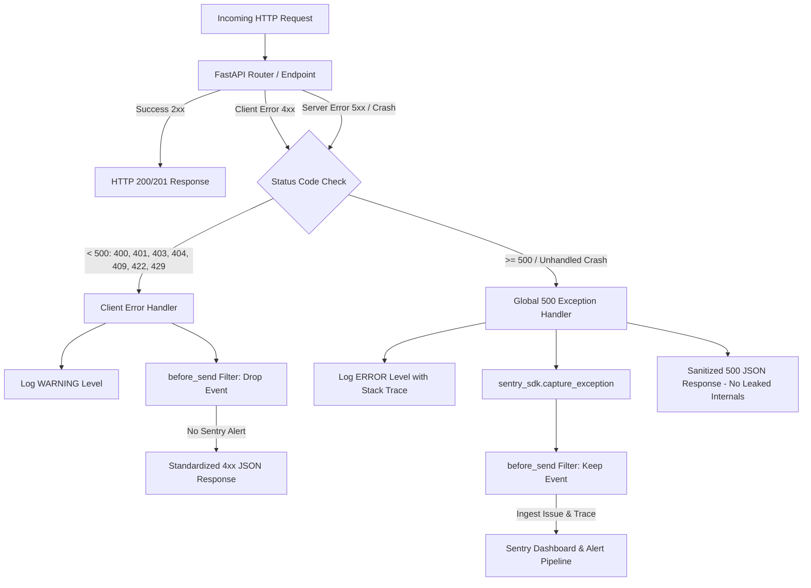

# Production Error Handling, Logging & Sentry Monitoring

This document details the production error handling pipeline, client error separation, and Sentry monitoring architecture implemented for the SetupSpot FastAPI backend.

---

## 1. Architecture Overview

In a production web application, error observability requires two distinct goals:
1. **Accurate Crash Reporting**: Immediate alerting and tracing for unexpected server failures (5xx, crashes, timeouts, database connection errors).
2. **Noise Suppression**: Preventing expected client-side errors (4xx validation errors, missing routes, wrong credentials) from creating false alerts and polluting the Sentry dashboard.



---

## 2. Sentry Early Initialization

Sentry SDK is initialized before the FastAPI application instance is created inside [`backend/main.py`](file:///home/creeksonjoseph/softwarengineering/personal-projects/SetupSpot/backend/main.py) via [`core/sentry.py`](file:///home/creeksonjoseph/softwarengineering/personal-projects/SetupSpot/backend/core/sentry.py).

### Configuration Options

```python
sentry_sdk.init(
    dsn=settings.SENTRY_DSN,
    environment=settings.ENVIRONMENT,
    send_default_pii=True,
    enable_logs=True,
    traces_sample_rate=1.0,
    profile_session_sample_rate=1.0,
    profile_lifecycle="trace",
    integrations=[
        FastApiIntegration(transaction_style="endpoint"),
        StarletteIntegration(transaction_style="endpoint"),
    ],
    before_send=before_send,
)
```

- **Early Execution**: Initializes before `app = FastAPI(...)` so ASGI lifespan, middleware, and dependency exceptions are captured.
- **Graceful Deactivation**: If `SENTRY_DSN` is empty or unset, `init_sentry()` logs an info message and exits cleanly without throwing an exception, allowing seamless offline development.
- **Full APM & Profiling**: `traces_sample_rate=1.0` and `profile_session_sample_rate=1.0` ensure end-to-end performance traces and CPU profiling for transactions.
- **Endpoint Transaction Style**: Groups performance transactions by FastAPI route endpoint rather than raw request URLs.

---

## 3. Strict 4xx vs 5xx Error Separation

### 3.1. Sentry Alert Suppression (`before_send`)

The custom `before_send` hook in [`core/sentry.py`](file:///home/creeksonjoseph/softwarengineering/personal-projects/SetupSpot/backend/core/sentry.py) inspects `hint["exc_info"]` before any event is ingested:

```python
def before_send(event: dict[str, Any], hint: dict[str, Any]) -> dict[str, Any] | None:
    if "exc_info" in hint and hint["exc_info"]:
        _, exc_value, _ = hint["exc_info"]

        # Drop 4xx HTTPExceptions (400, 401, 403, 404, 409, 429)
        if isinstance(exc_value, (HTTPException, StarletteHTTPException)):
            if getattr(exc_value, "status_code", 500) < 500:
                return None

        # Drop Pydantic / FastAPI schema validation errors (422)
        if isinstance(exc_value, RequestValidationError):
            return None

        # Drop custom domain exceptions with status_code < 500
        status_code = getattr(exc_value, "status_code", None)
        if isinstance(status_code, int) and status_code < 500:
            return None

    return event
```

### 3.2. Standardized Client Error Response (4xx)

Client errors are logged at `WARNING` level with request context and return clean, standardized JSON:

```json
{
  "success": false,
  "message": "User-safe error explanation",
  "detail": "User-safe error explanation",
  "code": "ERROR_CODE"
}
```

#### Status Code to Machine Code Mapping:

| HTTP Status | Error Code (`code`) | Trigger Reason |
| :--- | :--- | :--- |
| `400` | `BAD_REQUEST` | Malformed request parameters, invalid business inputs |
| `401` | `UNAUTHORIZED` | Missing or invalid auth token / credentials |
| `403` | `FORBIDDEN` | Authenticated user lacks permission for resource |
| `404` | `NOT_FOUND` | Route or resource does not exist |
| `405` | `METHOD_NOT_ALLOWED` | Invalid HTTP method on endpoint |
| `408` | `REQUEST_TIMEOUT` | Request timed out |
| `409` | `CONFLICT` | Resource already exists (e.g. email duplicate) |
| `422` | `VALIDATION_ERROR` | Pydantic body / parameter validation failure |
| `429` | `TOO_MANY_REQUESTS` | Rate limit exceeded |

### 3.3. Global 500 Exception Handler & Sanitization (5xx)

Unhandled crashes (e.g., `ZeroDivisionError`, database outages) and explicit 5xx `HTTPException`s trigger the global 500 exception handler:
1. Log the full stack trace at `ERROR` level using Python's logging module.
2. Ingest the error into Sentry via `sentry_sdk.capture_exception(exc)`.
3. Return a generic, safe JSON response that hides internal paths, SQL queries, and stack traces:

```json
{
  "success": false,
  "message": "An unexpected server error occurred. Please try again in a moment.",
  "detail": "An unexpected server error occurred. Please try again in a moment.",
  "code": "INTERNAL_SERVER_ERROR"
}
```

---

## 4. Environment Variables

Add the following environment variables to your deployment environment or `.env` file:

| Variable | Required | Description | Example |
| :--- | :--- | :--- | :--- |
| `SENTRY_DSN` | No (Production recommended) | Sentry Ingestion DSN URL | `https://450f2ab183fcbd70222b4d82ac5d59a2@o4512254075535360.ingest.de.sentry.io/4512254344822864` |
| `ENVIRONMENT` | No (Defaults to `development`) | Environment tag in Sentry (`production`, `staging`, `development`) | `production` |

---

## 5. Verification & Testing

### 5.1. Simulated Error Endpoint (`/api/sentry-debug`)

A verification route is available to test the end-to-end alerting pipeline:
- **URL**: `GET /api/sentry-debug` (or `GET /sentry-debug`)
- **Behavior**: Deliberately executes `1 / 0` (ZeroDivisionError)
- **Response**: Returns HTTP 500 with `{"code": "INTERNAL_SERVER_ERROR"}`
- **Sentry**: Emits a transaction trace and creates a new issue in your Sentry dashboard.

#### Test with cURL:
```bash
curl -i http://localhost:8000/api/sentry-debug
```

Expected HTTP Response:
```http
HTTP/1.1 500 Internal Server Error
Content-Type: application/json

{
  "success": false,
  "message": "An unexpected server error occurred. Please try again in a moment.",
  "detail": "An unexpected server error occurred. Please try again in a moment.",
  "code": "INTERNAL_SERVER_ERROR"
}
```

### 5.2. Automated Test Suite

A dedicated unit and integration test suite is located in [`backend/tests/test_error_handling_sentry.py`](file:///home/creeksonjoseph/softwarengineering/personal-projects/SetupSpot/backend/tests/test_error_handling_sentry.py).

Run the tests using `uv`:
```bash
cd backend
uv run pytest tests/test_error_handling_sentry.py -v
```

Tests verify:
- `404` and `400` return clean JSON and do not invoke Sentry capture.
- `422` validation errors return user-safe validation detail and do not invoke Sentry capture.
- `AppException` 4xx domain errors return formatted JSON without Sentry capture.
- `GET /api/sentry-debug` returns sanitized 500 JSON, hides Python tracebacks, and calls `sentry_sdk.capture_exception`.
- `before_send` hook drops 4xx events and preserves 5xx / crash events.
- Sentry gracefully remains inactive when `SENTRY_DSN` is unset or empty.
